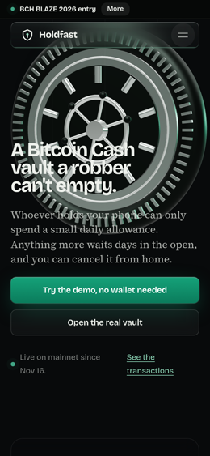
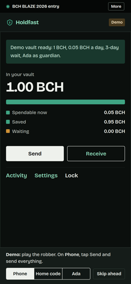
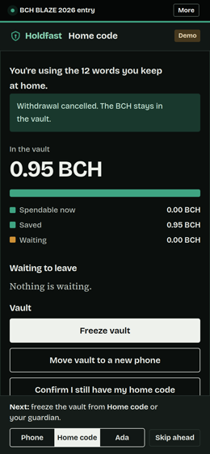

# Holdfast

<p align="center">
  
</p>

**A Bitcoin Cash vault a robber can't empty.**

Whoever has your phone can make you send what the phone can spend, and a Bitcoin Cash payment cannot be reversed. Holdfast is a vault contract: the phone can spend only a small daily allowance, and anything more waits in public so a home code or a guardian can cancel it.

**For judges:** watch the [1:40 video](https://youtu.be/Djiolje6bZU), or open the [demo](https://hodlfast.vercel.app/app/), tap **Start the demo**, then **Send**, **Use a sample address**, **Send all: 1.00 BCH**, **Review**, and **Send 1.00 BCH**. Then tap **Home code** and **Cancel withdrawal**. You should see **0.05 BCH** leave now and **0.95 BCH** come back.

## Quick Links

| What | What it needs |
| --- | --- |
| [Demo video](https://youtu.be/Djiolje6bZU) | 1:40, no setup |
| [Demo](#try-it-in-5-steps) | 5 steps, pretend money, no wallet |
| [Live site](#proof-its-real) | A browser |
| [Real vault](#what-works-today) | Paytaca, and a little BCH or chipnet |
| [Tests](#more-ways-to-test) | Node and npm, 118 tests |
| [How it was built](#built-during-bch-blaze-2026) | `git log --reverse` |

## Try It in 5 Steps

The [demo](https://hodlfast.vercel.app/app/) uses pretend money. No wallet and no signup.

1. Open the demo and tap **Start the demo**. You see **In your vault**, **1.00 BCH**, and **Demo vault ready: 1 BCH, 0.05 BCH a day, 3-day wait, Ada as guardian.**
2. Tap **Send**, then **Use a sample address**, then **Send all: 1.00 BCH**, then **Review**. You see **0.05 BCH leaves now** and **0.95 BCH waits 3 days**.
3. Tap **Send 1.00 BCH**. You see **Waiting to leave** and **0.95 BCH**. The **0.05 BCH** has already gone.
4. At the bottom, tap **Home code**, then **Cancel withdrawal**. You see **Withdrawal cancelled. The BCH stays in the vault.** and **Nothing is waiting.** **Saved** is **0.95 BCH**. **Spendable now** stays **0.00 BCH** until the allowance window refills, because the **0.05 BCH** already left.
5. Tap **Freeze vault**. You see **Vault frozen** and **Frozen by your home code.**

The words in bold are the words on the screen. The sample address is a demo address in the app, not a real wallet.

## Proof It's Real

- The rules are the contract [`contracts/Holdfast.cash`](contracts/Holdfast.cash) (`pragma cashscript ^0.14.0`).
- [`test/vault.test.ts`](test/vault.test.ts) runs 17 contract tests through the Bitcoin Cash VM, plus one state-encoding test.
- [`test/attacks.test.ts`](test/attacks.test.ts) replays every contract exploit from the 19 Nov reviews as a test that must fail. The raw reviews are in [`docs/reviews/judges/`](docs/reviews/judges/).
- `npm test` passes 118 tests (counted 19 Nov 2026).
- The site is live: [hodlfast.vercel.app](https://hodlfast.vercel.app). The same proof list is on [Security](https://hodlfast.vercel.app/security/#proof).
- **Contract version 2 on mainnet, 21 Nov 2026.** A second real vault ran on the current contract ([`contracts/Holdfast.cash`](contracts/Holdfast.cash)). The page ran on one phone and Paytaca on another (see [Known limitations](#known-limitations)). The duress PIN then opened a view showing only the 0.00026 BCH allowance. The release step is shown on version 1 below: this vault's 1-day wait would end after the submission deadline. There has been no outside audit.

| Step (version 2) | Transaction |
| --- | --- |
| Vault created from Paytaca over WizardConnect (0.003 BCH in) | [ae9de6a9](https://blockchair.com/bitcoin-cash/transaction/ae9de6a95eb84c9789cefea0ab763e7504344cdc4c2e54db2c54d1e74f4c18ca) |
| Phone spends within the allowance (0.0001); the 0.00002 fee also counts against the allowance | [b6a713b4](https://blockchair.com/bitcoin-cash/transaction/b6a713b4304483b1ca044e7ad3f68fe227b9b6a6a616cbd956de00d4c1100b50) |
| Phone starts a bigger withdrawal (0.001): it must wait 1 day | [5d0294b4](https://blockchair.com/bitcoin-cash/transaction/5d0294b417f1d570757130217c2c3a2853faa512fb015e2c2a59db0094ca6b9a) |
| Phone starts a second withdrawal (0.0005) | [14cdfb01](https://blockchair.com/bitcoin-cash/transaction/14cdfb0147874b151878261603f4b60ed7e6a9d58d005446aaedd02155c494ee) |
| Home code cancels the 0.0005 withdrawal, with no wallet involved | [0417c013](https://blockchair.com/bitcoin-cash/transaction/0417c013a48180d9ba834045a29f2ef6618eb5f48755ea99d4ece57186f32971) |
| Home code freezes the vault | [d45548cc](https://blockchair.com/bitcoin-cash/transaction/d45548cc9068f102de6d917fecafa9a87d622aaa4bbfb474ae3b46c71cdc1bba) |
| Home code cancels the 0.001 withdrawal while frozen, with no wallet involved | [7ba6f392](https://blockchair.com/bitcoin-cash/transaction/7ba6f3929c3e7ca3f21c9599e73418195d867f8f79f23f9eb07b0ba5a959b1bd) |
| Home code unfreezes the vault; the freeze and unfreeze fees came out of the allowance | [314e5fad](https://blockchair.com/bitcoin-cash/transaction/314e5fad770b5cc043c64585df4b8bd4644e5e2d145d3218810459ef5d8ba1a4) |

- **Contract version 1 on mainnet, 16 and 17 Nov 2026.** The first real vault ([`contracts/HoldfastV1.cash`](contracts/HoldfastV1.cash)). The 19 Nov review found holes in version 1, which version 2 closes; the app still opens version 1 vaults.

| Step (version 1) | Transaction |
| --- | --- |
| Vault created from Paytaca over WizardConnect (0.003 BCH in, 0.0001 fee) | [5d4e7cac](https://blockchair.com/bitcoin-cash/transaction/5d4e7cac3a9beca6235ef74a7bae37f239b78980a4b0d6b4f77f207cf329d519) |
| Phone spends within the allowance (0.0001), signed in Paytaca | [1243b504](https://blockchair.com/bitcoin-cash/transaction/1243b5043acc0dd0e8fb191c1af48e3fd3bdba25e840b8dc32d9f6c603686105) |
| Phone starts a bigger withdrawal (0.001): it must wait 1 day | [af31478b](https://blockchair.com/bitcoin-cash/transaction/af31478b5f9e91733e2684687f6d8fc51bb413a9c4d9d371b908aace1004fd2c) |
| Phone starts a second withdrawal (0.0005), the one cancelled below | [08f8538e](https://blockchair.com/bitcoin-cash/transaction/08f8538e8661d8af2598b6a8373f7203940fe65be1ff4a982f0c8350f8c49926) |
| Home code cancels a waiting withdrawal (0.0005) with no wallet involved | [fdec605d](https://blockchair.com/bitcoin-cash/transaction/fdec605dc778aa35902fcd7f60fc7b7e94e4bee79012ab3a742445a9f710741b) |
| After the wait, the withdrawal is released (0.00098 to the recipient, 2,000 sat fee), no wallet signature needed | [ba9ee1e9](https://blockchair.com/bitcoin-cash/transaction/ba9ee1e9121da03a31e2b8e5b35ddc5c8da00129272893437cd61886a0fe2495) |
| Home code freezes the vault | [4acd7c88](https://blockchair.com/bitcoin-cash/transaction/4acd7c88e0eb056e54733920a75f2c397fe42ad2a10876379f87ace0c404c15b) |
| Home code unfreezes the vault | [71d50061](https://blockchair.com/bitcoin-cash/transaction/71d50061870156c349af4fd07ddf09baa53524eb9d9608671e93db41818faadf) |
| Duress PIN quietly freezes the vault while showing only the allowance | [ad5c27ea](https://blockchair.com/bitcoin-cash/transaction/ad5c27ea0245f9140dfda45ea57a60490d33ce64028a0a728e2e19ef2e6baece) |
| Home code unfreezes it again | [48f2f9e4](https://blockchair.com/bitcoin-cash/transaction/48f2f9e44e6d4e79ac921f83a5c5769f45fc7fa81c89e05c638b3f6c6d21ffb9) |

## What's New Here

**A real PIN does not let the phone empty the vault.**

- **The phone can spend only the allowance in the current window, fees included.** `spend` requires the payment to equal `amount`, and counts what leaves the vault (payment plus fee) against the allowance: `spent + used <= allowance`, with `int(level) < 2`.
- **Anything bigger becomes a waiting withdrawal on the same address.** `startWithdrawal` mints that coin and counts its fee against the allowance. `release` pays only the recorded recipient, and only after `this.age >= waitBlocks`.
- **A home code or a guardian can cancel. Neither can quietly take the money.** Cancel is `merge`. Moving the whole vault is `recover`: it needs a full freeze and both recovery flags. With no guardian (`guardianPk == homePk`) the home code sets both flags alone, so `recover` also needs the vault coin to be `waitBlocks` old.
- **A duress key can freeze without blocking the allowance.** `freeze` with the panic key sets level 1. Level 2, from the home code or a guardian, blocks spends, new withdrawals and phone or panic merges. No freeze stops `release` on a withdrawal whose wait is over, so the app's home-code and duress flows cancel every waiting withdrawal.

People already lose money this way. The [Why](https://hodlfast.vercel.app/why/) page states two sourced figures. One is ₦2.6 million from a bank app after a robbery at gunpoint in September 2025 ([WeeTracker](https://weetracker.com/2025/10/07/panic-mode-banking-nigeria-duress-features); the link path is dated 7 Oct 2025). The other is 72 verified "wrench attacks" in 2025, up 75% on 2024 ([Decrypt](https://decrypt.co/356604/41m-in-losses-as-crypto-wrench-attacks-hit-record-high-in-2025), 2 Feb 2026).

## How Bitcoin Cash Is Used

- **CashScript 0.14 covenants.** [`contracts/Holdfast.cash`](contracts/Holdfast.cash) checks signatures, fixes its own outputs, and carries state in CashToken NFT commitments. Waits use `this.age` (a relative time lock), not a timestamp the spender picks. Phone spends, withdrawal starts, freezes, approvals and guardian-replacement starts all record their fee against the allowance (each capped, 2,500 or 3,500 sats); merges pay up to 4,000 from the coin merged in; release pays at most 2,000. `recover` and `evict` move everything and have no fee cap. With no guardian, `approveFast` is refused.
- **libauth 3.1.0-next.8.** The real vault and the signing test use it for addresses, hashes, and transaction bytes (`src/vault.ts`, `src/real/core.ts`, `src/main.ts`).
- **WizardConnect 0.2 and Paytaca.** [`src/real/wallet.ts`](src/real/wallet.ts) connects the real vault to Paytaca. The same path is what the pre-kickoff signing test used.
- **In the repo, not in the vault app.** `contracts/SignTest.cash` and `contracts/CoSignTest.cash` are the chipnet signing tests, reached from [/signing-test/](https://hodlfast.vercel.app/signing-test/). Telegram alerts and a guardian-for-hire service are named on the [Why](https://hodlfast.vercel.app/why/) page as later work. There is no code that sends those alerts.

The app's builders use 144 blocks for about a day, 6 blocks for about an hour, and 1,008 blocks for about a week (`src/vault.ts`). The contract checks whatever block counts were set when the vault was created. The demo uses a 0.05 BCH allowance and a 3-day wait. A real vault can use 1 to 7 days. The site says 3 is the default.

## How It Compares

Our row is first. A cell says Not stated when this repo does not give the date or the fact.

| Product | What a forced phone can still take | Source | Date |
| --- | --- | --- | --- |
| Holdfast | The daily allowance now. The rest waits and can be cancelled. | [Contract](contracts/Holdfast.cash) and the [mainnet list](#proof-its-real) | 16 and 17 Nov 2026 |
| Kuda Panic Balance | Not stated here. The Why page says it shows a lower balance when you shake the phone, and that money still moves if they make you send it. | [Kuda help](https://help.kuda.com/en/articles/8943120-use-private-mode) | Not stated |
| Discovery Bank panic PIN | Not stated here. The Why page says a panic PIN alerts its fraud team. | [TechCentral](https://techcentral.co.za/discovery-bank-panic-code-app-kidnappings/261422/) | 27 Mar 2025 |
| Deus Wallet duress mode | Not stated here. The Why page says duress mode opens a decoy account. | [Chainwire press release on Decrypt](https://decrypt.co/297742/deus-wallet-introduces-duress-mode-the-revolutionary-solution-for-cryptocurrency-security) | 19 Dec 2024 |

A bank can call a fraud team. Holdfast cannot. Bitcoin Cash that has already left, including the allowance, is gone. The [Security](https://hodlfast.vercel.app/security/) page says that in those words.

## What Works Today

| Piece | State |
| --- | --- |
| Vault contract | Version 2 in the repo, with 17 VM contract tests and 14 attack tests. Version 1 kept for older vaults. No outside audit. |
| Demo | Live at [/app/](https://hodlfast.vercel.app/app/). Pretend BCH in the browser. |
| Real vault | Live at [/real/](https://hodlfast.vercel.app/real/). Paytaca on mainnet or chipnet. Mainnet steps in the table above. |
| Signing test | Live at [/signing-test/](https://hodlfast.vercel.app/signing-test/). Five chipnet tests from before kickoff are listed on the [Security](https://hodlfast.vercel.app/security/#proof) page. |
| Website | Live at [hodlfast.vercel.app](https://hodlfast.vercel.app). |
| Telegram alerts | Not built. Listed on the Why page as later work. |
| Guardian-for-hire | Not built. The Why page lists it under "Later". |

## More Ways to Test

<details>
<summary><strong>Run the tests (118 tests, Node and npm)</strong></summary>

```bash
npm install
npm test
```

Vitest should report `Tests  118 passed`.

</details>

<details>
<summary><strong>Build the site (Node and npm)</strong></summary>

```bash
npm run build
git checkout -- src/*.artifact.ts
```

`npm run build` compiles the three CashScript contracts, typechecks, and runs Vite. The checkout puts the generated artifact files back so they do not stay as a local change.

</details>

<details>
<summary><strong>Run it locally (Node and npm)</strong></summary>

```bash
git clone https://github.com/ohjay-official/holdfast.git
cd holdfast
npm install
npm run dev
```

Vite prints a local address. Its usual default is http://localhost:5173 . Open `/app/` for the demo.

</details>

<details>
<summary><strong>Mainnet run (Paytaca and a small amount of BCH)</strong></summary>

Open [the real vault](https://hodlfast.vercel.app/real/). The screen says **Mainnet** or **Chipnet (test)**. The app charges a one-time 0.0001 BCH Holdfast fee when you create a vault (`CREATE_FEE` in `src/real/core.ts`). That fee is not a line in the contract. Until there is an outside audit, the site says to start with a small amount.

</details>

## Screenshots

Shots of the live site on 18 Nov 2026. The in-app shots are the demo, which uses pretend BCH.

<p align="center">
  
</p>

<p align="center">
  
</p>

<p align="center">
  
</p>

## What It Does

1. You open the demo, or you connect Paytaca and create a real vault.
2. You pick a daily allowance and a wait from 1 to 7 days.
3. You write down a 12-word home code. A guardian is optional. With no guardian, the home code fills the guardian's role.
4. The phone spends up to the allowance immediately (`spend`, with `fresh` after the refill age). Each spend's fee counts against the allowance.
5. A larger send starts a waiting withdrawal. When the wait is over, anyone can release it to the saved recipient. No new signature is required for `release`.
6. The home code or a guardian can cancel that withdrawal (`merge`) or freeze the vault coin.
7. Unfreezing needs the home code and the guardian. Moving everything also needs a full freeze. With no guardian one home-code approval does both jobs, and moving everything also waits the normal wait.

What it cannot promise:

- It cannot reverse Bitcoin Cash that has already left, including the allowance.
- A freeze never stops `release`: a waiting withdrawal still leaves when its wait ends unless it's cancelled with `merge`. The real app's home-code and duress flows cancel every waiting withdrawal (`lockDown` in `src/real/core.ts`); after a guardian freeze, the guardian has to tap Cancel on each one.
- If someone has both the phone and the home code, the contract cannot tell them from you. With a guardian they still need the guardian, or a week to replace them; with no guardian they need a full freeze and your normal wait.
- The page you type your home code into is this website. Check the code, or run it yourself.
- Starting and cancelling withdrawals in a loop can still burn a few times the daily allowance in network fees. It can't move money out.
- The PIN protects the screen, not the money. With the browser's storage in hand, a 4 to 6 digit PIN can be guessed offline. The contract limits still hold.
- Version 1 vaults (before 19 Nov) still have the holes the review found. The app tells their owners to move out.
- There has been no outside audit.

## Security and What It Doesn't Promise

There is no `docs/SECURITY` file in this repo. The write-up is the live page: [Security](https://hodlfast.vercel.app/security/).

The short version is the list in [What It Does](#what-it-does). Read that page before you put in more than a small amount.

### Known limitations

- **One iPhone running both the page and Paytaca can stall on signing.** iOS pauses whichever app is in the background, so the request can sit on the WizardConnect relay without reaching Paytaca. On 20 and 21 Nov this happened several times in Chrome and Safari on one iPhone, and nothing was sent or lost. The same request went straight through with the page on a second phone and Paytaca on the first. The app now says so when Paytaca has shown nothing for 25 seconds. The planned fix is a built-in signer, so a vault doesn't need a second app.
- **The vault lives in the browser that made it.** To open it on another device you need the vault code and the home code.
- **Starting and cancelling withdrawals in a loop can burn a few times the allowance a day in fees,** though it can't move money out ([Under the hood](https://hodlfast.vercel.app/under-the-hood/)). The PIN only guards this app's screen; the contract never sees it. Version 1 vaults keep the holes the 19 Nov review found, so the app asks their owners to move to a new vault.

## Privacy

The live [Privacy](https://hodlfast.vercel.app/privacy/) page is the current note (last updated 19 Nov 2026 on that page).

The app keeps vault settings, the duress key and slow-hashed PINs in the browser. Vault actions are public Bitcoin Cash transactions, and every vault pays its creation fee to one project address, so vaults can be listed. The real app reads public Electrum servers named on that page. WizardConnect uses public Nostr relays. The site is hosted on Vercel, and Vercel Web Analytics counts page views without cookies. Fonts are files from this site.

## Run Your Own

```bash
git clone https://github.com/ohjay-official/holdfast.git
cd holdfast
npm install
npm test
npm run build
git checkout -- src/*.artifact.ts
npm run dev
```

No environment variables are required for the demo. The real vault talks to public servers from the browser. Do not put keys or secrets in the repo.

## Repository

| | |
| --- | --- |
| Code | https://github.com/ohjay-official/holdfast |
| License | [MIT](LICENSE) |
| Issues | https://github.com/ohjay-official/holdfast/issues |
| Live site | https://hodlfast.vercel.app |
| Kickoff snapshot | [`nov14-start`](https://github.com/ohjay-official/holdfast/tree/nov14-start) (`03f53db`, 11 Nov 2026) and https://holdfast-kickoff.vercel.app |
| Hackathon | [BCH BLAZE 2026](https://dorahacks.io/hackathon/bchblaze2026) |

No BCH BLAZE track id is written in this repo, so there is no tracks table.

## Built During BCH BLAZE 2026

**First commit `5149a2f` was 11 Nov 2026, 11:36 UTC, which is 12:36 in Lagos (UTC+1).** That is before the site's kickoff mark of 14 Nov 2026. It was the chipnet signing test, not the vault.

```bash
git log --reverse --format='%h %ad %s' --date=format:'%Y-%m-%d %H:%M %z'
```

<details>
<summary><strong>What landed each day (Lagos dates)</strong></summary>

- **11 Nov:** WizardConnect signing test on chipnet, including a two-signer spend.
- **14 Nov:** Public site, demo app, and the vault contract with its first 18 tests.
- **15 Nov:** Judge bar, Why and Under the hood pages, pitch deck, and the real vault app.
- **16 Nov:** First mainnet vault, the allowance spend, a waiting withdrawal, a home-code cancel, and PIN-length fixes.
- **17 Nov:** More tests, docs aligned with the contract, home code on a new phone with the vault code, and the PIN redraw fix.
- **18 Nov:** Repeated-digit PIN fix, the Nov 17 mainnet transactions written into the docs, and the Night Vault site.
- **19 Nov:** Three independent reviews (cold judge, security, claims). Contract version 2 closes every contract hole they found, with an attack test for each; app fixes for the duress view, server checks, PIN storage and security headers; public wording matched to the code.
- **20 Nov:** Site polish, the vault door on phones, and setup that survives a reload.
- **21 Nov:** Contract version 2 run on mainnet (table above), and a hint when Paytaca hasn't shown a request.

</details>

Code, tests and docs were written with AI tools (Claude, Grok Bot and Cursor Agent), directed by Faithful Adejoh (Oh-Jay). He made the product decisions and did every wallet step and every real-money test.

Libraries from `package-lock.json` on this commit:

**Runtime:** `@bitauth/libauth` 3.1.0-next.8, `@wizardconnect/core` 0.2.5, `@wizardconnect/dapp` 0.2.2, `cashscript` 0.14.0, `qrcode` 1.5.4, `three` 0.170.0, `@types/three` 0.170.0, `@fontsource-variable/bricolage-grotesque` 5.3.0, `@fontsource-variable/jetbrains-mono` 5.3.0, `@fontsource-variable/source-serif-4` 5.3.1.

**Dev:** `cashc` 0.14.0, `typescript` 7.0.2, `vite` 8.3.8, `vitest` 5.1.0, `@types/qrcode` 1.5.6.

**Services:** Vercel hosts the site. The real app reads the public Electrum servers named on the Privacy page. WizardConnect uses public Nostr relays. No API keys are stored in the repo.

## License

[MIT](LICENSE). Copyright (c) 2026 ohjay-official.
